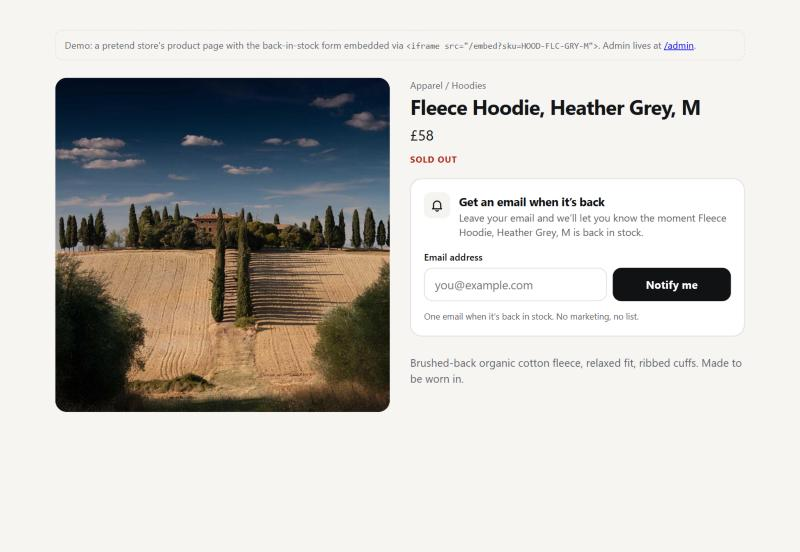
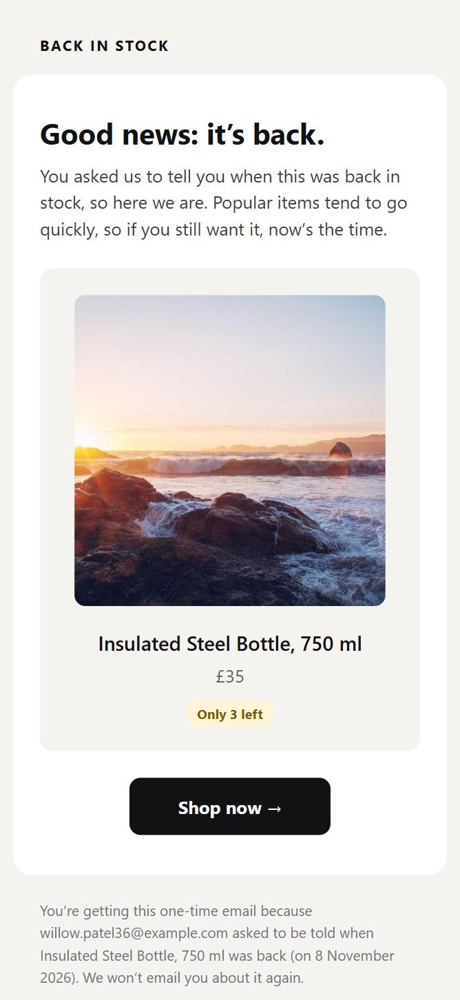
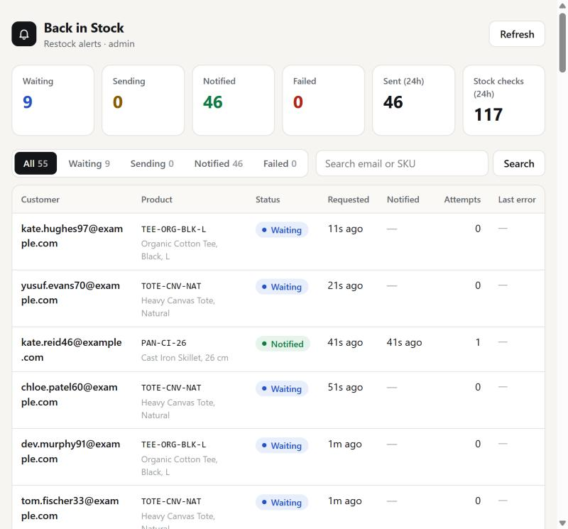

# back-in-stock-alerts

**Live:** TODO (deploy pending) · **Admin:** `/admin` · **Embed:** `/embed?sku=TEE-ORG-WHT-M`

Customers leave their email on a sold-out product; when it really comes back, they get one good-looking email. The service takes the sign-ups, listens for stock webhooks, double-checks every restock with the stock API, and sends exactly one email per request, through duplicate webhooks, fake restocks, failing email sends and restarts.

| Embed (in an iframe on the store) | Email | Admin |
|---|---|---|
|  |  |  |

Harness run against the challenge harness (local copy, simulated store every 10s for ~12 minutes): 18 duplicate webhook deliveries, 3 phantom restocks, a forged-secret webhook, 15 injected email failures (HTTP 500), a graceful restart, two `docker kill`s during retry backoff and four redeploys onto the same volume. Result: 57 requests, 46 notified, **46 accepted emails, each matched one-to-one to a request; no duplicates, no one left waiting on an in-stock product**, 0 failed. Inbox: [`docs/harness-inbox.jpg`](docs/harness-inbox.jpg). Checked with `scripts/verify-harness.mjs` (see [Verifying a run](#verifying-a-run)).

## Run it

```bash
docker build -t back-in-stock-alerts .
docker run --rm -p 8080:8080 -v bis-data:/data \
  -e PORT=8080 \
  -e STOCK_API_URL=https://<harness>/api/stock -e STOCK_API_KEY=... \
  -e RESEND_API_KEY=... -e RESEND_BASE_URL=https://<harness> \
  -e WEBHOOK_SECRET=... -e ADMIN_PASSWORD=... \
  back-in-stock-alerts
```

Only the brief's variables are needed. Data lives in SQLite under `DATA_DIR` (a `VOLUME`, default `/data`); no external database. The image is multi-stage `node:22-slim`, runs as a non-root user, has a `HEALTHCHECK` on `/healthz`, and shuts down gracefully on `SIGTERM`.

### Environment

| Variable | Required | Purpose |
|---|---|---|
| `PORT` | yes | HTTP port (default 8080) |
| `STOCK_API_URL` | yes | `GET {url}/{sku}` → `{ sku, name, price, image, quantity, in_stock }` |
| `STOCK_API_KEY` | yes | Bearer token for the stock API |
| `RESEND_API_KEY` | yes | Bearer token for the email API |
| `RESEND_BASE_URL` | yes | Emails are POSTed to `{RESEND_BASE_URL}/emails` (never api.resend.com) |
| `WEBHOOK_SECRET` | yes | Expected `X-Webhook-Secret` on `/webhooks/stock` |
| `ADMIN_PASSWORD` | yes | HTTP Basic password for `/admin` (any username) |
| `DATA_DIR` | no | SQLite directory, default `/data` |
| `EMAIL_FROM` | no | Default `Back in Stock <alerts@example.com>` |
| `SHOP_URL` | no | Product link template for the email's button, `{sku}` is replaced. Default `https://shop.example.com/products/{sku}`. If the embed knows the product page (`?url=` or the iframe's referrer) that link wins. |
| `PUBLIC_URL` | no | This service's public URL (informational) |

See [`.env.example`](.env.example).

### Local development

```bash
npm install          # Node 22+
cp .env.example .env # fill in values, then export them (or use your shell's dotenv)
DATA_DIR=./data npm run dev
npm test             # vitest, no network: stock API and Resend are faked by a local server
npm run typecheck
```

Against the challenge harness locally: `node harness/server.js` in a clone of the challenge repo, sign up at `http://localhost:3000`, copy the env block from the dashboard, run this app, and save its URL in the dashboard.

## Endpoints

| | |
|---|---|
| `GET /embed?sku=&accent=&url=` | Email form for an iframe. `sku` prefills and hides the product field, `accent` (hex) themes the button, `url` is the product page used in the email. `frame-ancestors *`, no `X-Frame-Options`. Works without JS (plain form POST, server-rendered result) and with JS (inline result, `postMessage` of its height so the store can size the iframe). |
| `POST /api/requests` | `{ email, sku }` as JSON (or form-encoded from the no-JS embed). `201` new, `200` already on the list (same open request returned), `400` invalid, `413` too large. |
| `POST /webhooks/stock` | `{ event_id, type, sku, quantity, occurred_at }` + `X-Webhook-Secret`. `401` bad secret, `400` garbage, `200` otherwise (including duplicates and when the stock API is down). |
| `GET /admin` | Basic auth. Counts, filter by status, search, every request with status, requested/notified time, attempts and last error; recent webhooks with their outcome. `Cache-Control: no-store`. |
| `GET /healthz` | `200 {"ok":true}` after a DB round trip. |
| `GET /` | A pretend store product page with the embed in an iframe. |

Embedding:

```html
<iframe src="https://<this-service>/embed?sku=TEE-ORG-WHT-M" title="Back in stock alert"
        style="width:100%;border:0;height:220px" id="bis"></iframe>
<script>
  addEventListener('message', (e) => {
    if (e.data?.type === 'back-in-stock:height') document.getElementById('bis').style.height = e.data.height + 'px';
  });
</script>
```

## How customers get exactly one email

1. **One open request per person and product.** A partial unique index on `(email, sku) WHERE status IN ('pending','sending')` makes the database reject a second open row, so ten simultaneous submits create one request. Once notified, the same person can sign up again.
2. **Duplicate webhooks stop at the door.** Each event's `event_id` is a primary key; the second delivery, even at the same millisecond, hits the conflict and gets `200 duplicate`.
3. **The webhook is only a hint.** Every restock is confirmed with the stock API (`in_stock && quantity > 0`). Phantom restocks are recorded as `not_confirmed` and email nobody.
4. **Claim before send.** A worker moves a request `pending → sending` with one conditional `UPDATE … WHERE status='pending'`; only the caller that changed the row sends. Stock is rechecked right before a batch, and if it sold out again the requests stay pending.
5. **Every send carries `Idempotency-Key: back-in-stock/{request id}`.** If a send times out, fails with 5xx, or the process dies after the provider accepted it, the retry uses the same key and the provider drops the duplicate. Request ids are random UUIDs, so a wiped database can never collide with old keys.
6. **Failures retry, then stop.** 5xx, 408, 409, timeouts and network errors go back to `pending` with exponential backoff and jitter (2s, 4s, 8s … up to 10 attempts, then `failed` with the reason). 429 waits for `Retry-After`. Other 4xx fail immediately.
7. **Restarts lose nothing.** On boot, rows left in `sending` by a dead process go back to `pending` and are resent with the same key. Pending retries get a timer again.
8. **A sweeper covers missed webhooks.** Every 60s it takes the distinct SKUs that have due pending requests and makes one stock call per SKU (not per request), then sends. A lost, late or "stock API was down" webhook is picked up within a minute.

### Decisions

- **Signing up for something already in stock:** the request is stored and the customer gets the email straight away (after the same stock recheck), and the embed says "it's in stock now, we've emailed you a link". The customer asked to be told; a link in their inbox is useful, and it keeps one rule for everyone instead of a special case that drops their intent.
- **Low stock:** everyone waiting is notified, even if 3 left and 20 waiting. We can't know who will buy, a missed alert is worse than a late one, and the email says "Only 3 left" and that stock isn't reserved.
- **Sell-out webhooks** (`quantity: 0`) are recorded without a stock API call; we never email on them.
- **Rejected deliveries** (`bad_secret`, `invalid`, and duplicates) are logged in a separate `webhook_log` table, not in `webhook_events`. An unauthenticated request with a real event id must not be able to take that id and make the genuine delivery look like a duplicate.
- **Secrets** are compared by hashing both sides and using `crypto.timingSafeEqual`, so neither content nor length leaks through timing.
- **Stock API down during a webhook:** the event is stored as `unverified`, the sender gets `200` (retrying wouldn't help), and the worker re-checks shortly after; the sweeper backs it up.

## Data model

| Table | Purpose |
|---|---|
| `requests` | id (UUID), email (trimmed, lower-cased), sku, status `pending → sending → notified / failed`, created/claimed/notified at, attempts, next_attempt_at, last_error, resend_email_id |
| `webhook_events` | authenticated events by `event_id` (PK): claimed quantity, outcome (`confirmed`, `not_confirmed`, `sellout`, `unverified`), quantity the stock API reported, delivery count |
| `webhook_log` | every delivery incl. `duplicate`, `bad_secret`, `invalid` (admin view) |
| `products` / `stock_checks` | last known product details for emails and the embed; an audit of every stock API call |

SQLite in WAL mode with `busy_timeout`; migrations run on boot. `better-sqlite3` is synchronous, so each claim and insert is atomic within the process.

## Verifying a run

```bash
docker cp harness:/data/db.json ./harness.json
docker exec bis-app node -e "require('better-sqlite3')('/data/back-in-stock.db').backup('/tmp/s.db')" && docker cp bis-app:/tmp/s.db ./app.db
node scripts/verify-harness.mjs ./harness.json ./app.db
```

It fails if any notified request doesn't have exactly one accepted email with its key, if the provider accepted an email we don't know about, or if someone is still waiting more than 90s for a product the harness has in stock.

## Tests

`npm test`: 22 tests, no network (a local fake plays both the stock API and Resend, honouring `Idempotency-Key` like the harness):

- same `event_id` twice concurrently → one event, one email
- phantom restock → `not_confirmed`, no email
- wrong / missing / longer secret → 401, no side effects, and the forged attempt doesn't block the real event
- Resend 500, 500, 200 → one `notified`, same idempotency key on all three calls
- crash after the provider accepted but before we recorded it → restart resends with the same key → provider has one email
- crash after claim, before sending → restart sends it; restart during backoff → retried when due
- 4xx → `failed`, 429 → honours `Retry-After`, gives up after max attempts
- duplicate and concurrent sign-ups → one open row; a notified request can be reopened
- malformed JSON / bad fields / huge bodies → 400 / 413, never 500
- sweeper: one stock call per SKU; sold out again → stays pending
- embed headers and escaping, admin auth + `no-store`, email escaping

## What I'd add for real production

- **Postgres + a job queue** (e.g. pg-boss or SQS) so several instances can run; the claim becomes `UPDATE … RETURNING` / `SKIP LOCKED`.
- **Per-store tenancy:** stores, API keys and per-store webhook secrets, branding and sender domains.
- **Unsubscribe / manage link** and one-click `List-Unsubscribe`, plus double opt-in where the law wants it.
- **Rate limits and bot protection** on `/api/requests` (per IP and per email), and signed (HMAC) webhooks with a timestamp instead of a shared header.
- **Metrics and alerts:** queue depth, oldest pending, send failure rate, stock API latency; structured logs to a sink.
- **Fairness on low stock:** notify in waves (oldest first) when demand far exceeds stock.
- Resend keeps idempotency keys for 24h; a long outage beyond that would need an extra "already sent?" lookup before resending.

## AI tools and time

- AI tools used: TODO
- Time taken: TODO
